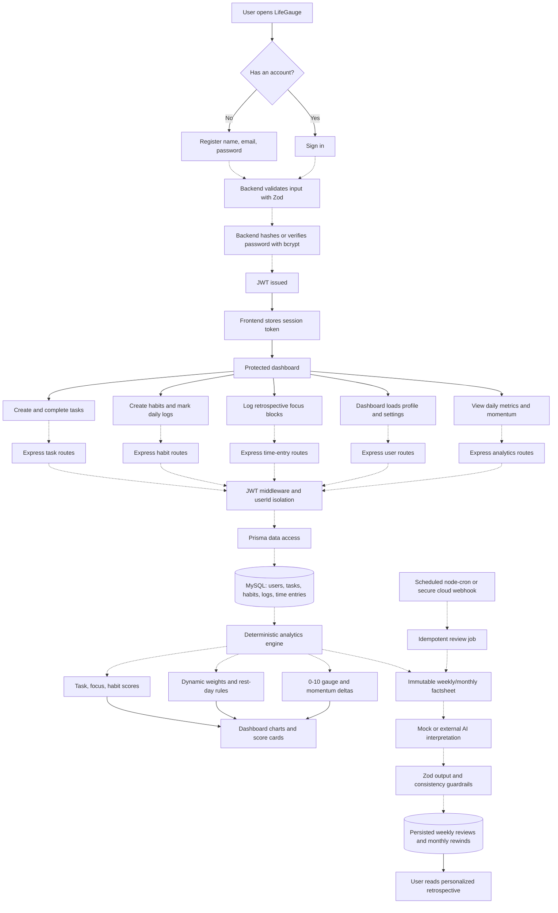
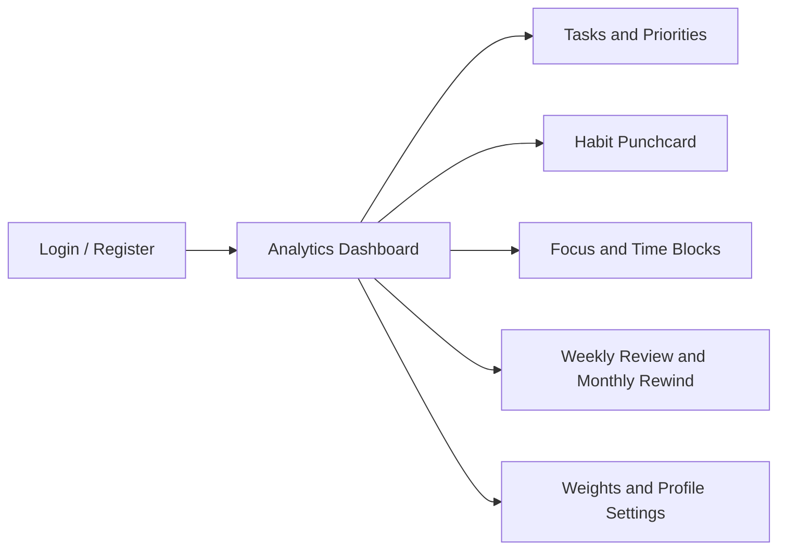

# LifeGauge: Completed Product User Journey

This diagram shows the intended experience when the project is fully completed. It includes the browser journey, backend processes, database, analytics, AI retrospectives, and scheduled jobs described by the project specification.

* [ ] Solid arrows represent browser-visible screens, user actions, and responses rendered in the frontend. Dotted arrows represent server-side work, database access, analytics, validation, scheduling, and AI processing that the user does not see directly.

## Intended Finished Screens

* [ ] The finished system keeps deterministic calculations in the backend. AI interprets prepared factsheets but does not calculate or invent the user's metrics.
