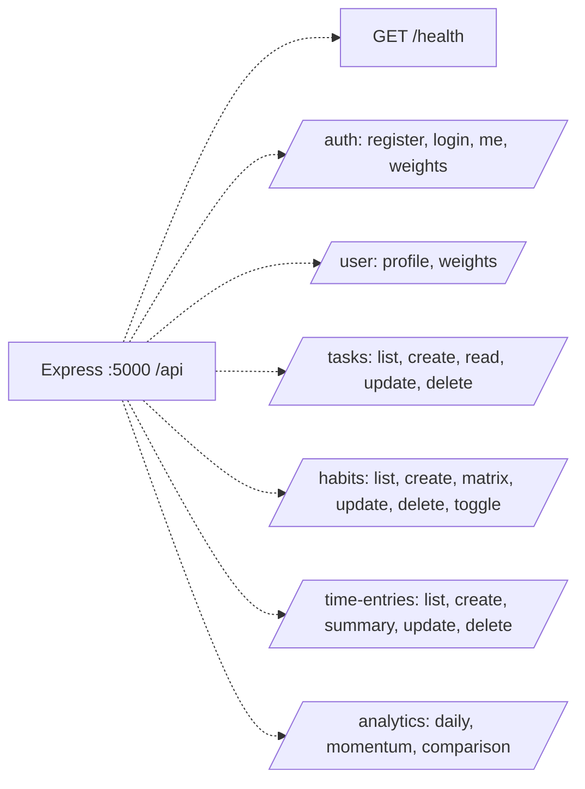

# LifeGauge: Current Implemented User Journey

This diagram describes only the code that currently exists. It does not treat planned documentation as implemented functionality.

```mermaid
flowchart TD
    A[User opens http://localhost:5173] --> B[React App and BrowserRouter]
    B --> C[/login route]
    C --> D{Register or sign in}
    D -.->|POST /api/auth/register| E[Express auth controller]
    D -.->|POST /api/auth/login| E
    E -.-> F[bcrypt validation and JWT creation]
    F --> G[AuthContext stores JWT in localStorage]
    G --> H[ProtectedRoute allows application pages]

    H --> I[Dashboard /]
    H --> J[Tasks /tasks]
    H --> K[Habits /habits]
    H --> L[Time /time]

    I -.-> I1[GET /api/analytics/daily]
    I -.-> I2[GET /api/tasks?dueDate=...]
    I -.-> I3[GET /api/habits/matrix]
    I -.-> I4[GET /api/analytics/momentum]
    I -.-> I5[GET /api/time-entries/summary]
    I -.-> I6[POST /api/tasks, /api/habits, /api/time-entries]

    J -.-> J1[GET /api/tasks]
    J -.-> J2[POST /api/tasks]
    J -.-> J3[PATCH /api/tasks/:id]
    J -.-> J4[DELETE /api/tasks/:id]

    K -.-> K1[GET /api/habits]
    K -.-> K2[POST /api/habits]
    K -.-> K3[POST /api/habits/:id/toggle]
    K -.-> K4[DELETE /api/habits/:id]
    K -.-> K5[GET /api/habits/matrix]

    L -.-> L1[GET /api/time-entries]
    L -.-> L2[POST /api/time-entries]
    L -.-> L3[GET /api/time-entries/summary]
    L -.-> L4[DELETE /api/time-entries/:id]

    G -.-> M[GET /api/user/profile on session restore]
    H -.-> N[PUT /api/user/weights from settings]

    I1 -.-> O[JWT middleware]
    I2 -.-> O
    I3 -.-> O
    I4 -.-> O
    I5 -.-> O
    J1 -.-> O
    J2 -.-> O
    J3 -.-> O
    J4 -.-> O
    K1 -.-> O
    K2 -.-> O
    K3 -.-> O
    K4 -.-> O
    K5 -.-> O
    L1 -.-> O
    L2 -.-> O
    L3 -.-> O
    L4 -.-> O
    M -.-> O
    N -.-> O

    O -.-> P[Controller validates request]
    P -.-> Q[Prisma client]
    Q -.-> R[(MySQL database)]
    Q -.-> S[analyticsService for daily scores and momentum]
    S --> T[JSON response rendered by React charts and lists]
```

Solid arrows represent browser-visible navigation or a response returned to the frontend. Dotted arrows represent API requests and backend-only work such as authentication, validation, Prisma/MySQL access, and analytics calculations.

## Current Endpoint Surface



The health endpoint can be typed directly into a browser:

```text
http://localhost:5000/api/health
```

The frontend should be opened at:

```text
http://localhost:5173
```

`backend/dist` is not another runtime flow in this diagram. It is the JavaScript output generated from `backend/src` by the backend build command.
